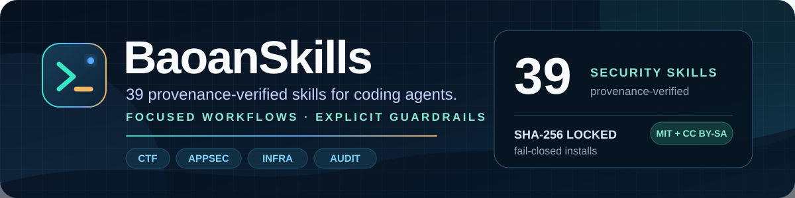
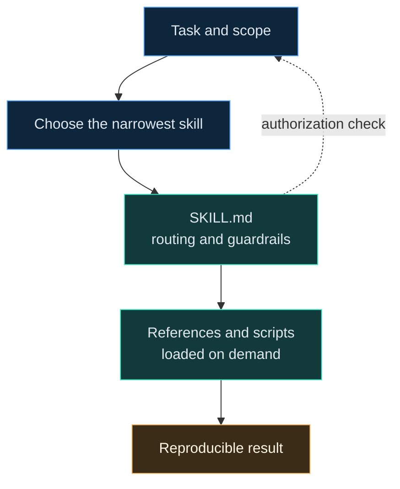

<p align="center">
  
</p>

<p align="center">
  <a href="#quick-start">Quick start</a> ·
  <a href="#starter-bundles">Starter bundles</a> ·
  <a href="#skill-catalog">Skill catalog</a> ·
  <a href="docs/ROUTING.md">Routing guide</a> ·
  <a href="docs/INSTALL.md">Install guide</a> ·
  <a href="CHANGELOG.md">Changelog</a> ·
  <a href="README.zh-CN.md">简体中文</a>
</p>

<p align="center">
  <a href="https://github.com/baoan778/BaoanSkills/releases/latest"></a>
  <a href="https://github.com/baoan778/BaoanSkills/actions/workflows/validate.yml"></a>
  <a href="https://github.com/baoan778/BaoanSkills/actions/workflows/codeql.yml"></a>
  
  <a href="NOTICE"></a>
</p>

<p align="center">
  <strong>39 security skills. One disciplined workflow.</strong><br>
  Focused playbooks, on-demand references, and explicit authorization boundaries.
</p>

A provenance-aware collection of 39 security skills for Codex-compatible agents.
Use them for CTF solving, authorized application security testing, privilege
assessment, and security auditing without loading the entire library into context.

## Quick start

**Requirements:** Python 3.10+, Git, and Codex or another agent that discovers
`SKILL.md` directories.

### macOS / Linux

```bash
git clone https://github.com/baoan778/BaoanSkills.git && cd BaoanSkills && python3 scripts/install_skills.py solve-challenge ctf-web ctf-crypto ctf-writeup
```

### Windows PowerShell

```powershell
git clone https://github.com/baoan778/BaoanSkills.git; Set-Location BaoanSkills; python scripts\install_skills.py solve-challenge ctf-web ctf-crypto ctf-writeup
```

Restart or reload your agent after installation. The default destination is
`$CODEX_HOME/skills` when `CODEX_HOME` is set, otherwise `~/.codex/skills`.
Use `--dest PATH` for another location and `--force` to update existing skills.

[Release archives](https://github.com/baoan778/BaoanSkills/releases/latest),
checksum verification, updates, and troubleshooting are documented in the
**[installation guide](docs/INSTALL.md)**.

> [!IMPORTANT]
> **Authorized use only.** Use these skills only in CTF environments, owned labs,
> or systems for which you have explicit written permission. A public target, a
> discovered service, or the presence of a tool is never authorization. Read
> [docs/AUTHORIZATION.md](docs/AUTHORIZATION.md) before active testing.

## Why BaoanSkills

- **Focused execution.** A short `SKILL.md` entrypoint selects the narrowest
  workflow and loads detailed references only when the task needs them.
- **Reproducible results.** Evidence requirements, stop conditions, and output
  criteria make agent runs easier to review and repeat.
- **Safe by default.** Every skill starts with an authorization boundary and
  scope-aware execution rules.
- **Trust through provenance.** Pinned upstream sources, license evidence,
  per-file SHA-256 locks, and fail-closed installation make the payload
  inspectable.
- **Install only what you need.** The dependency-free installer supports one
  skill, a starter bundle, or the full catalog.

## Choose a starting point

- **Unfamiliar CTF bundle:** start with `solve-challenge`; route to the narrowest
  specialist after triage.
- **Crypto, web, reverse, pwn, or forensics:** use `ctf-crypto`, `ctf-web`,
  `ctf-reverse`, `ctf-pwn`, or `ctf-forensics`.
- **Authorized application testing:** start with
  `ethical-hacking-methodology` or `top-web-vulnerabilities`, then specialize by
  vulnerability class.
- **Cloud and host review:** use `aws-penetration-testing`,
  `linux-privilege-escalation`, or `windows-privilege-escalation`.
- **Code, CI, and AI workflow audit:** use `semgrep-rule-creator`,
  `agentic-actions-auditor`, or `burpsuite-project-parser`.
- **Looking for a local reference:** use `ctf-knowledge-base` for lookup, then
  hand the actual solve to the matching specialist.

The complete routing rules and overlap guidance live in
[docs/ROUTING.md](docs/ROUTING.md).

## Starter bundles

These are copy-ready installs for common goals. On macOS or Linux, use `python3`
instead of `python` when required.

<details>
<summary><strong>CTF fundamentals</strong> · 7 skills</summary>

```bash
python scripts/install_skills.py solve-challenge ctf-web ctf-crypto ctf-forensics ctf-reverse ctf-pwn ctf-writeup
```

</details>

<details>
<summary><strong>Authorized web testing</strong> · 6 skills</summary>

```bash
python scripts/install_skills.py ethical-hacking-methodology top-web-vulnerabilities sql-injection-testing xss-html-injection idor-testing pentest-checklist
```

</details>

<details>
<summary><strong>Cloud and host review</strong> · 4 skills</summary>

```bash
python scripts/install_skills.py aws-penetration-testing linux-privilege-escalation windows-privilege-escalation ssh-penetration-testing
```

</details>

<details>
<summary><strong>Code and CI audit</strong> · 3 skills</summary>

```bash
python scripts/install_skills.py agentic-actions-auditor semgrep-rule-creator burpsuite-project-parser
```

</details>

<details>
<summary><strong>Everything</strong> · 39 skills</summary>

```bash
python scripts/install_skills.py --all
```

</details>

## Skill catalog

<details>
<summary><strong>CTF · 12 skills</strong></summary>

`ctf-ai-ml` · `ctf-crypto` · `ctf-forensics` · `ctf-knowledge-base` · `ctf-malware` ·
`ctf-misc` · `ctf-osint` · `ctf-pwn` · `ctf-reverse` · `ctf-web` · `ctf-writeup` ·
`solve-challenge`

</details>

<details>
<summary><strong>Application security and code review · 16 skills</strong></summary>

`agentic-actions-auditor` · `api-fuzzing-bug-bounty` · `broken-authentication` ·
`ethical-hacking-methodology` · `file-path-traversal` · `html-injection-testing` ·
`idor-testing` · `pentest-checklist` · `pentest-commands` · `red-team-tools` ·
`smtp-penetration-testing` · `sql-injection-testing` · `sqlmap-database-pentesting` ·
`top-web-vulnerabilities` · `wordpress-penetration-testing` · `xss-html-injection`

</details>

<details>
<summary><strong>Cloud, identity, and infrastructure · 5 skills</strong></summary>

`aws-penetration-testing` · `linux-privilege-escalation` ·
`privilege-escalation-methods` · `ssh-penetration-testing` ·
`windows-privilege-escalation`

</details>

<details>
<summary><strong>Tools, scanning, and supply chain · 6 skills</strong></summary>

`burpsuite-project-parser` · `metasploit-framework` · `scanning-tools` ·
`semgrep-rule-creator` · `shodan-reconnaissance` · `wireshark-analysis`

</details>

Browse descriptions, risk levels, licenses, and direct links in the generated
**[skill catalog](docs/SKILLS_INDEX.md)**.

## How a skill is used



Each skill uses **progressive disclosure**:

- frontmatter gives the agent a concise discovery description;
- `SKILL.md` contains the routing decision, authorization boundary, core
  workflow, and output criteria;
- `references/` and `scripts/` carry detailed material that is loaded only when
  the current task needs it.

This keeps context focused while preserving the depth needed for real work.

<details>
<summary><strong>Show example prompts</strong></summary>

```text
Use the ctf-crypto skill to analyze the attached RSA challenge and produce a
reproducible solve path with the recovered flag.
```

```text
Use the idor-testing skill to review the API endpoints in ./lab-scope.json.
The written scope and test window are in ./AUTHORIZATION.md. Stop before any
request outside that scope.
```

```text
Use agentic-actions-auditor to review the AI-agent workflows under
.github/workflows for prompt-injection and secret-exposure risks.
```

```text
Use semgrep-rule-creator to turn this vulnerable code pattern into a tested
Semgrep rule with positive and negative fixtures.
```

</details>

## Provenance and quality

The release allowlist is [release/public-skills.txt](release/public-skills.txt).
Every published skill file is locked by SHA-256 in
[release/provenance.lock.json](release/provenance.lock.json).

<details>
<summary><strong>Origin and license summary</strong> · 39 skills</summary>

| Origin | Skills | License | Source |
|---|---:|---|---|
| Original CTF workflows | 12 | MIT | BaoanSkills contributors |
| Authorized security testing | 24 | MIT | `zebbern/claude-code-guide` at a pinned commit |
| Security auditing tools | 3 | CC BY-SA 4.0 | `trailofbits/skills` at a pinned commit |

</details>

Additional guarantees:

- the installer verifies requested files before copying and aborts on any
  missing, extra, symlinked, or hash-mismatched file;
- release archives include SHA-256 checksum files and are smoke-tested before
  publication;
- CI validates Linux and Windows across Python 3.10, 3.11, and 3.12;
- CodeQL, gitleaks, link checks, resource checks, Markdown checks, provenance
  checks, and release-readiness checks are required quality gates.

Read [docs/PROVENANCE.md](docs/PROVENANCE.md) and
[docs/SKILL_REVIEW.md](docs/SKILL_REVIEW.md) for the review model.

## Development

```bash
python3 -m pip install -r requirements-dev.txt
python3 -m pre_commit install
python3 scripts/check_all.py
```

`check_all.py` runs the same release-scoped quality suite used by CI. See
[CONTRIBUTING.md](CONTRIBUTING.md) before changing skills, routing metadata,
generated files, or the provenance lock.

## Security and license

Do not open a public issue containing live credentials, private target data, or
unpatched vulnerability details. Follow [SECURITY.md](SECURITY.md) for private
reporting and disclosure guidance.

Repository scaffolding, scripts, documentation, and the 12 original CTF skills
use the root [MIT License](LICENSE). The 24 skills derived from
`zebbern/claude-code-guide` are MIT-licensed. The 3 skills derived from
`trailofbits/skills` are CC BY-SA 4.0. Attribution and full license texts are in
[NOTICE](NOTICE) and [licenses/](licenses/).

The root MIT License does not relicense third-party material. `source: original`
records the maintainer's attribution for the 12 CTF skills; no external
historical record was available to independently prove that status.

## Contributing

Contributions are welcome when they preserve provenance, licensing, routing
quality, and the authorization boundary. Start with
[CONTRIBUTING.md](CONTRIBUTING.md),
[docs/ADDING_A_SKILL.md](docs/ADDING_A_SKILL.md), and
[docs/SKILL_REVIEW.md](docs/SKILL_REVIEW.md).

Maintained by [@baoan778](https://github.com/baoan778).
