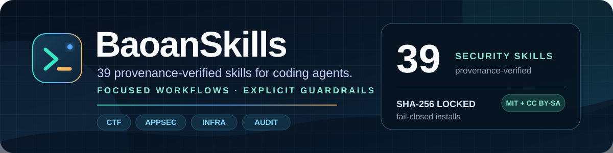
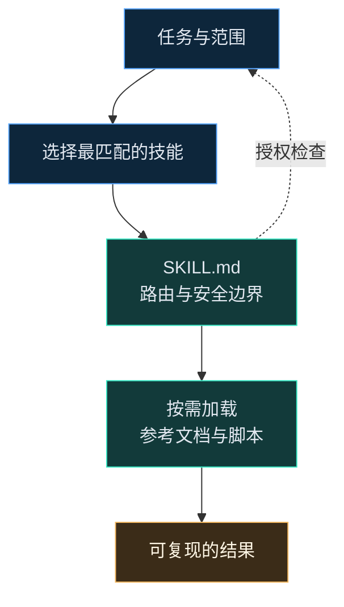

<p align="center">
  
</p>

<p align="center">
  <a href="README.md">English</a> · <strong>简体中文</strong>
</p>

<p align="center">
  <a href="#快速开始">快速开始</a> ·
  <a href="#推荐组合">推荐组合</a> ·
  <a href="#技能目录">技能目录</a> ·
  <a href="docs/ROUTING.md">路由指南</a> ·
  <a href="docs/INSTALL.md">安装指南</a> ·
  <a href="CHANGELOG.md">更新日志</a>
</p>

<p align="center">
  <a href="https://github.com/baoan778/BaoanSkills/releases/latest"></a>
  <a href="https://github.com/baoan778/BaoanSkills/actions/workflows/validate.yml"></a>
  <a href="https://github.com/baoan778/BaoanSkills/actions/workflows/codeql.yml"></a>
  
  <a href="NOTICE"></a>
</p>

<p align="center">
  <strong>39 个安全技能，一套有纪律的工作流。</strong><br>
  聚焦的执行路径、按需加载的知识、明确的授权边界。
</p>

BaoanSkills 是面向 Codex 及兼容智能体的开源安全技能库，包含
**39 个可验证来源的安全技能**，覆盖 CTF、授权应用安全测试、权限评估和安全审计。
每个技能只在需要时加载对应资料，不需要把整个知识库塞进上下文。

## 快速开始

**环境要求：** Python 3.10+、Git，以及支持 `SKILL.md` 的 Codex 或兼容智能体。

### macOS / Linux

```bash
git clone https://github.com/baoan778/BaoanSkills.git && cd BaoanSkills && python3 scripts/install_skills.py solve-challenge ctf-web ctf-crypto ctf-writeup
```

### Windows PowerShell

```powershell
git clone https://github.com/baoan778/BaoanSkills.git; Set-Location BaoanSkills; python scripts\install_skills.py solve-challenge ctf-web ctf-crypto ctf-writeup
```

安装后重启或重新加载智能体。默认安装目录为 `$CODEX_HOME/skills`（已设置
`CODEX_HOME` 时）或 `~/.codex/skills`。使用 `--dest PATH` 指定其他目录，
使用 `--force` 更新已安装技能。

发布包下载、SHA-256 校验、更新和故障排查请见
**[安装指南](docs/INSTALL.md)**。

> [!IMPORTANT]
> **仅限授权使用。** 这些技能只能用于 CTF 环境、自有实验环境，或已获得明确书面授权的系统。公开目标、扫描结果或工具存在本身都不构成授权。执行主动测试前请阅读 [授权边界](docs/AUTHORIZATION.md)。

## 为什么选择 BaoanSkills

- **聚焦执行。** 用简短的 `SKILL.md` 入口选择最窄工作流，只在任务需要时加载详细参考。
- **结果可复现。** 明确证据标准、停止条件和输出要求，让每次代理运行都更容易复核和重跑。
- **默认安全。** 每个技能都包含授权边界和范围感知的执行规则。
- **来源可信。** 固定上游提交、保留许可证证据、逐文件 SHA-256 锁定，安装失败即中止。
- **按需安装。** 无额外运行时依赖的安装器支持单项、组合或全量安装。

## 从哪里开始

- **不熟悉的 CTF 题目包：** 先用 `solve-challenge`，分类明确后转入更窄的专项技能。
- **密码、Web、逆向、Pwn 或取证：** 使用 `ctf-crypto`、`ctf-web`、`ctf-reverse`、`ctf-pwn` 或 `ctf-forensics`。
- **授权的应用安全测试：** 从 `ethical-hacking-methodology` 或 `top-web-vulnerabilities` 开始，再按漏洞类别细化。
- **云与主机评估：** 使用 `aws-penetration-testing`、`linux-privilege-escalation` 或 `windows-privilege-escalation`。
- **代码、CI 与 AI 工作流审计：** 使用 `semgrep-rule-creator`、`agentic-actions-auditor` 或 `burpsuite-project-parser`。
- **本地知识检索：** 使用 `ctf-knowledge-base` 查找资料，再把实际求解交给匹配的专项技能。

完整路由与重叠规则见 [docs/ROUTING.md](docs/ROUTING.md)。

## 推荐组合

以下命令可直接复制使用。macOS 或 Linux 没有 `python` 命令时，请改用 `python3`。

<details>
<summary><strong>CTF 基础组合</strong> · 7 个技能</summary>

```bash
python scripts/install_skills.py solve-challenge ctf-web ctf-crypto ctf-forensics ctf-reverse ctf-pwn ctf-writeup
```

</details>

<details>
<summary><strong>授权 Web 测试</strong> · 6 个技能</summary>

```bash
python scripts/install_skills.py ethical-hacking-methodology top-web-vulnerabilities sql-injection-testing xss-html-injection idor-testing pentest-checklist
```

</details>

<details>
<summary><strong>云与主机评估</strong> · 4 个技能</summary>

```bash
python scripts/install_skills.py aws-penetration-testing linux-privilege-escalation windows-privilege-escalation ssh-penetration-testing
```

</details>

<details>
<summary><strong>代码与 CI 审计</strong> · 3 个技能</summary>

```bash
python scripts/install_skills.py agentic-actions-auditor semgrep-rule-creator burpsuite-project-parser
```

</details>

<details>
<summary><strong>安装全部技能</strong> · 39 个技能</summary>

```bash
python scripts/install_skills.py --all
```

</details>

## 技能目录

<details>
<summary><strong>CTF · 12 个技能</strong></summary>

`ctf-ai-ml` · `ctf-crypto` · `ctf-forensics` · `ctf-knowledge-base` · `ctf-malware` ·
`ctf-misc` · `ctf-osint` · `ctf-pwn` · `ctf-reverse` · `ctf-web` · `ctf-writeup` ·
`solve-challenge`

</details>

<details>
<summary><strong>应用安全与代码审查 · 16 个技能</strong></summary>

`agentic-actions-auditor` · `api-fuzzing-bug-bounty` · `broken-authentication` ·
`ethical-hacking-methodology` · `file-path-traversal` · `html-injection-testing` ·
`idor-testing` · `pentest-checklist` · `pentest-commands` · `red-team-tools` ·
`smtp-penetration-testing` · `sql-injection-testing` · `sqlmap-database-pentesting` ·
`top-web-vulnerabilities` · `wordpress-penetration-testing` · `xss-html-injection`

</details>

<details>
<summary><strong>云、身份与基础设施 · 5 个技能</strong></summary>

`aws-penetration-testing` · `linux-privilege-escalation` ·
`privilege-escalation-methods` · `ssh-penetration-testing` ·
`windows-privilege-escalation`

</details>

<details>
<summary><strong>工具、扫描与供应链 · 6 个技能</strong></summary>

`burpsuite-project-parser` · `metasploit-framework` · `scanning-tools` ·
`semgrep-rule-creator` · `shodan-reconnaissance` · `wireshark-analysis`

</details>

完整描述、风险等级、许可证和技能入口见
**[技能目录](docs/SKILLS_INDEX.md)**。

## 工作方式



每个技能都采用**渐进式披露**：

- frontmatter 提供简短、可检索的发现描述；
- `SKILL.md` 包含路由判断、授权边界、核心工作流和输出标准；
- `references/` 与 `scripts/` 保存详细资料，只在当前任务需要时加载。

这样既能控制上下文体积，又能保留真实工作所需的深度。

<details>
<summary><strong>查看使用示例</strong></summary>

```text
使用 ctf-crypto 技能分析附件中的 RSA 题目，给出可复现的解题路径并恢复 flag。
```

```text
使用 idor-testing 技能审查 ./lab-scope.json 中的 API。
书面授权和测试时间窗口位于 ./AUTHORIZATION.md，任何超出范围的请求都必须停止。
```

```text
使用 agentic-actions-auditor 审查 .github/workflows 中调用 AI 智能体的工作流，
重点检查提示注入、权限边界和密钥暴露风险。
```

```text
使用 semgrep-rule-creator 将这个脆弱代码模式转换为经过正反例测试的 Semgrep 规则。
```

</details>

## 来源与质量

发布范围由 [release/public-skills.txt](release/public-skills.txt) 控制，每个公开技能
文件都在 [release/provenance.lock.json](release/provenance.lock.json) 中记录 SHA-256。

<details>
<summary><strong>来源与许可证摘要</strong> · 39 个技能</summary>

| 来源 | 技能数 | 许可证 | 上游 |
|---|---:|---|---|
| 原创 CTF 工作流 | 12 | MIT | BaoanSkills 贡献者 |
| 授权安全测试 | 24 | MIT | `zebbern/claude-code-guide`（固定提交） |
| 安全审计工具 | 3 | CC BY-SA 4.0 | `trailofbits/skills`（固定提交） |

</details>

补充保证：

- 安装器会在复制前验证请求的全部文件；缺失、额外、符号链接或哈希不匹配都会中止安装；
- 发布包使用单一 ZIP，并附带 SHA-256 校验清单，在发布前完成解压、示例安装和篡改拒绝测试；
- CI 覆盖 Linux、Windows、Python 3.10–3.12；
- CodeQL、gitleaks、链接、资源、Markdown、来源和发布就绪检查是必需质量门禁。

来源审查模型见 [docs/PROVENANCE.md](docs/PROVENANCE.md) 与
[docs/SKILL_REVIEW.md](docs/SKILL_REVIEW.md)。

## 开发与贡献

```bash
python3 -m pip install -r requirements-dev.txt
python3 -m pre_commit install
python3 scripts/check_all.py
```

`check_all.py` 会运行与 CI 一致的完整质量检查。修改技能、路由元数据、生成文件
或来源锁之前，请先阅读 [CONTRIBUTING.md](CONTRIBUTING.md)。

## 安全与许可证

不要在公开 Issue 中提交真实凭据、私有目标数据或未修复漏洞细节。私密报告方式
见 [SECURITY.md](SECURITY.md)。

仓库脚手架、脚本、文档和 12 个原创 CTF 技能使用根目录
[MIT License](LICENSE)；来自 `zebbern/claude-code-guide` 的 24 个技能为 MIT；
来自 `trailofbits/skills` 的 3 个技能为 CC BY-SA 4.0。完整归属与许可证文本见
[NOTICE](NOTICE) 和 [licenses/](licenses/)。

根目录 MIT 许可证不会重新许可第三方材料。`source: original` 表示维护者对其余
12 个 CTF 技能的归属声明；目前没有可用于独立证明该状态的外部历史记录。

## 参与贡献

欢迎在保留来源、许可证、路由质量和授权边界的前提下参与贡献。请先阅读
[CONTRIBUTING.md](CONTRIBUTING.md)、
[docs/ADDING_A_SKILL.md](docs/ADDING_A_SKILL.md) 和
[docs/SKILL_REVIEW.md](docs/SKILL_REVIEW.md)。

由 [@baoan778](https://github.com/baoan778) 维护。
